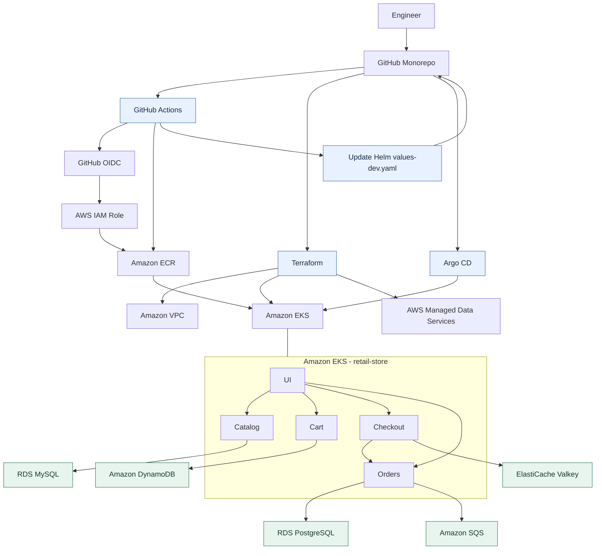
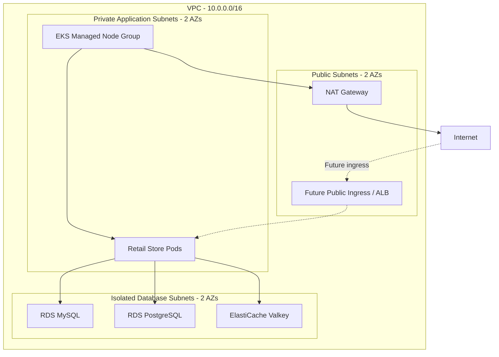
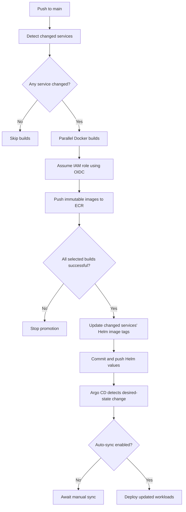
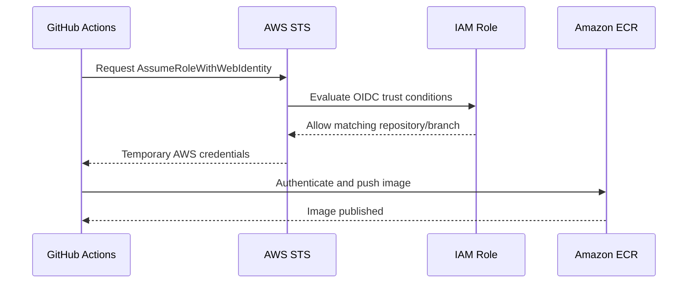
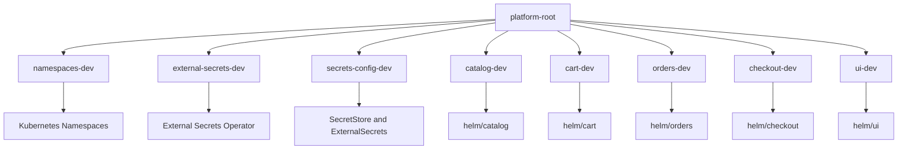
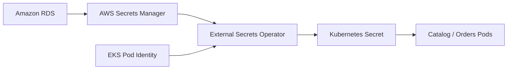

# AWS Platform Engineering Lab

**An end-to-end AWS platform engineering project built with Terraform, Amazon EKS, GitHub Actions, Helm, Argo CD, and AWS-managed data services.**

[](https://aws.amazon.com/)
[](https://www.terraform.io/)
[](https://kubernetes.io/)
[](https://helm.sh/)
[](https://argo-cd.readthedocs.io/)
[](https://github.com/features/actions)

> **Project status — October 2026**
>
> Container build and image-promotion automation is implemented and tested. Terraform infrastructure configurations, five Helm charts, and GitOps deployment manifests have been prepared. The complete EKS environment and end-to-end application deployment are pending integration testing.
>
> This is a hands-on engineering lab, not a production-certified platform.

---

## Overview

This repository demonstrates the design and implementation of a cloud-native application platform on AWS.

Rather than building a new e-commerce application, the project uses the [AWS Containers Retail Store Sample Application](https://github.com/aws-containers/retail-store-sample-app) as a realistic microservices workload.

The primary engineering work focuses on the platform surrounding those applications:

- Infrastructure provisioning and lifecycle management with Terraform.
- AWS networking, private services, IAM, and workload identities.
- Docker image builds and publishing to Amazon ECR.
- Keyless CI authentication using GitHub Actions and AWS OIDC.
- Immutable image tagging and automated GitOps image promotion.
- Independent Helm charts for each microservice.
- Declarative application management using Argo CD App-of-Apps.
- AWS Secrets Manager integration through External Secrets Operator.
- Operational verification, troubleshooting, security, and cost-aware infrastructure design.

The goal is to build a reproducible development platform that can be created when needed, experimented with, and destroyed to control costs.

### What this project demonstrates

| Area | Implementation |
|---|---|
| Infrastructure as Code | Terraform-managed AWS resources and remote state |
| Containerization | Dockerfiles and separate container images for five services |
| CI | GitHub Actions matrix builds with change detection |
| Authentication | GitHub OIDC federation to AWS IAM |
| Image registry | Private Amazon ECR repositories |
| Artifact strategy | Immutable, traceable container image tags |
| Continuous delivery | GitOps image promotion followed by Argo CD reconciliation |
| Kubernetes packaging | Independently maintained Helm charts |
| Platform bootstrap | Argo CD App-of-Apps pattern |
| Workload identity | EKS Pod Identity for AWS service access |
| Secret management | AWS Secrets Manager and External Secrets Operator |
| Data services | RDS, DynamoDB, ElastiCache Valkey, and SQS |
| Cost management | Ephemeral infrastructure and planned teardown workflow |

---

## Architecture

### 1. Platform architecture



This diagram represents the intended fully deployed architecture. The CI/ECR portion is already operational; the EKS deployment is the next integration milestone.

### 2. AWS network design

The initial environment is designed around a single VPC in `eu-central-1`.



The design includes:

- Two Availability Zones.
- Public subnets for NAT and future ingress resources.
- Private subnets for EKS worker nodes.
- Isolated subnets for database and cache resources.
- A single NAT Gateway to reduce lab costs.
- Security Group restrictions between application and database components.

**Trade-off:** A single NAT Gateway and a single worker node reduce cost but introduce single points of failure. These choices are intentional for a development lab and should be revisited for production environments.

---

## Application Services

The application consists of five independently containerized microservices.

| Service | Responsibility | Main dependency |
|---|---|---|
| `ui` | Web interface and backend API integration | Other microservices |
| `catalog` | Product catalog | Amazon RDS MySQL |
| `cart` | Shopping cart management | Amazon DynamoDB |
| `orders` | Order management | Amazon RDS PostgreSQL and SQS |
| `checkout` | Checkout session workflow | ElastiCache Valkey and Orders API |

All five images are stored in separate private ECR repositories.

The upstream application source is maintained under `apps/`. The main focus of this repository is adapting, packaging, deploying, and operating these applications on AWS.

---

## Repository Structure

```text
aws-platform-lab/
├── .github/
│   └── workflows/
│       └── build-push-ecr.yaml
│
├── apps/
│   ├── cart/
│   ├── catalog/
│   ├── checkout/
│   ├── orders/
│   └── ui/
│
├── terraform/
│   ├── bootstrap/
│   └── environments/
│       └── dev/
│           ├── ecr.tf
│           ├── iam.tf
│           └── ...
│
├── helm/
│   ├── cart/
│   ├── catalog/
│   ├── checkout/
│   ├── orders/
│   └── ui/
│
├── gitops/
│   ├── argocd/
│   │   ├── bootstrap/
│   │   │   └── root-app.yaml
│   │   └── applications/
│   │       └── dev/
│   └── platform/
│       ├── namespaces/
│       └── external-secrets/
│
├── .gitignore
└── README.md
```

Each Helm chart follows a common structure:

```text
helm/catalog/
├── Chart.yaml
├── values.yaml
├── values-dev.yaml
└── templates/
    ├── _helpers.tpl
    ├── deployment.yaml
    ├── service.yaml
    └── serviceaccount.yaml
```

Environment-specific values are stored alongside their charts. This allows Argo CD to deploy the same chart with different configuration files.

The current implemented environment is `dev`. The design allows future `staging` and `prod` configuration files without requiring separate copies of the application templates.

---

## CI/CD and GitOps

### Automated image build and promotion

The CI workflow is defined in:

`.github/workflows/build-push-ecr.yaml`

It implements the following sequence:



### Change detection

The workflow uses `dorny/paths-filter` to identify changed service directories.

For example, if only `apps/cart/` changes, only the Cart image is rebuilt.

A manual `workflow_dispatch` run builds all five services.

### Immutable image tags

Every build receives a traceable image tag:

```text
sha-<12-character-commit-sha>-<github-run-id>-<run-attempt>
```

Example:

```text
sha-abc123def456-123456789-1
```

This avoids relying on a mutable `latest` tag and makes individual deployments traceable to Git commits and workflow executions.

### Automated Helm updates

After all selected builds succeed, GitHub Actions updates only the matching `values-dev.yaml` files.

For example:

```yaml
image:
  repository: <account-id>.dkr.ecr.eu-central-1.amazonaws.com/aws-platform-lab-dev/cart
  tag: "sha-abc123def456-123456789-1"
```

The changes are committed to Git automatically.

The promotion workflow includes safeguards against concurrent updates and attempts to avoid promoting an outdated service build over newer source code.

### Why GitOps?

Git is the source of truth for application deployment configuration.

GitHub Actions is responsible for building and publishing images, not directly applying Kubernetes manifests.

Argo CD is responsible for reconciling the declared application state with the cluster.

This separation provides:

- Traceability from source commit to container image.
- Version-controlled deployment configuration.
- Reviewable changes and deployment history.
- A foundation for drift detection and rollback.
- Reduced coupling between CI and cluster credentials.

**Current behavior:** Image promotion works. Application auto-sync remains disabled until the first EKS integration is validated.

---

## Infrastructure Design

Terraform manages the AWS infrastructure.

| Component | Planned configuration |
|---|---|
| Region | `eu-central-1` (Frankfurt) |
| VPC | `10.0.0.0/16`, two Availability Zones |
| NAT | One NAT Gateway |
| EKS | Kubernetes 1.36, standard support |
| Compute | One `t3.large` managed node |
| ECR | Five private repositories |
| MySQL | RDS MySQL 8.4, `db.t4g.micro` |
| PostgreSQL | RDS PostgreSQL 18.6, `db.t4g.micro` |
| Cache | ElastiCache Valkey 7.2 |
| DynamoDB | On-demand billing |
| Messaging | SQS with dead-letter queue |
| Secrets | AWS Secrets Manager |
| Workload identity | EKS Pod Identity |
| Terraform state | S3 remote backend |

Versions and instance types reflect the current development configuration and may need adjustment depending on AWS region availability and provider compatibility.

### Infrastructure lifecycle

Long-lived infrastructure and disposable lab infrastructure serve different purposes.

**Long-lived resources:**

- Terraform state bucket.
- Private ECR repositories and their images.
- GitHub OIDC provider and CI IAM role.

**Ephemeral lab resources:**

- VPC and associated network resources.
- EKS cluster and workers.
- RDS instances.
- ElastiCache.
- DynamoDB and SQS resources.
- Other resources provisioned specifically for a lab session.

An important future improvement is separating persistent and ephemeral infrastructure into independent Terraform states so that a normal lab teardown cannot accidentally remove container repositories or CI identities.

---

# Deployment Guide

This section describes the intended first-time installation process.

**Important:** The repository contains environment-specific defaults for the original lab account. Deploying into another AWS account requires updating resource names, backend configuration, IAM trust conditions, GitHub repository information, and container image references.

The commands below provide the deployment sequence. Review the actual Terraform inputs and resource names before executing destructive or billable commands.

## 1. Prerequisites

Install:

- Git
- AWS CLI v2
- Terraform
- Docker with Buildx
- `kubectl`
- Helm 3 or a compatible supported Helm version
- Python 3
- Optional: `yq`, for YAML inspection

Verify installation:

```bash
git --version
aws --version
terraform version
docker version
kubectl version --client
helm version
python3 --version
```

You also need:

1. An AWS account with permissions to provision networking, EKS, IAM, RDS, ECR, ElastiCache, DynamoDB, SQS, and Secrets Manager resources.
2. An AWS CLI profile configured for that account.
3. A GitHub repository containing this project.
4. Permission to configure GitHub Actions variables and workflow permissions.
5. An understanding that deploying the full environment incurs AWS charges.

## 2. Clone the repository

```bash
git clone https://github.com/mehmetbozyel/aws-platform-lab.git

cd aws-platform-lab
```

The project can be forked, but the Terraform IAM trust configuration and GitHub repository references must be adjusted for the fork.

## 3. Configure AWS authentication

Configure a named AWS CLI profile:

```bash
aws configure --profile retail-lab
```

Alternatively, use your organization's AWS IAM Identity Center / SSO authentication.

Select the profile:

```bash
export AWS_PROFILE=retail-lab
export AWS_REGION=eu-central-1
```

Verify the caller identity:

```bash
aws sts get-caller-identity
```

Ensure the returned account is the account where you intend to create infrastructure.

Never commit AWS access keys or credentials to the repository.

## 4. Configure account-specific values

Before provisioning anything, inspect:

```text
terraform/environments/dev/
helm/*/values-dev.yaml
gitops/argocd/
gitops/platform/external-secrets/
.github/workflows/build-push-ecr.yaml
```

The reference deployment uses:

```text
AWS Region: eu-central-1
EKS Cluster: aws-platform-lab-dev-eks
Application Namespace: retail-store
External Secrets Namespace: external-secrets
ECR Prefix: aws-platform-lab-dev
```

When deploying to another account, update at least:

- AWS account ID in ECR registry URLs.
- Terraform backend bucket and key configuration.
- GitHub OIDC trust policy repository identity and branch conditions.
- GitHub repository URLs in Argo CD Applications.
- Any hardcoded account-specific IAM policy resources.
- EKS API access restrictions.
- Region-specific settings, if changing AWS regions.

The existing CI OIDC trust policy is scoped to this project's GitHub repository. A fork cannot assume the original IAM role without corresponding trust-policy changes.

## 5. Bootstrap Terraform remote state

The Terraform environment uses an S3 backend.

A new AWS account will not already have the original project's state bucket.

Before `terraform init`, create or configure an S3 bucket for remote state. The bucket must be in the intended region and should have:

- S3 Block Public Access enabled.
- Bucket versioning enabled.
- Server-side encryption enabled.
- Appropriate IAM access restrictions.

Use the repository's bootstrap configuration where available, or create an equivalent state bucket using a reviewed bootstrap procedure.

Then ensure the Terraform backend configuration references **your bucket**, not the original project account.

Initialize:

```bash
cd terraform/environments/dev

terraform init
terraform validate
```

Review the configured backend before initialization. Do not automatically migrate another environment's existing state into a new account.

For Terraform configurations using an S3 lockfile, the IAM identity must also have the required access to the state and lock objects.

## 6. Review Terraform before apply

Run:

```bash
terraform fmt -check -recursive
terraform validate
terraform plan -out=tfplan
```

Examine the plan carefully.

Review:

- VPC and subnet CIDRs.
- EKS cluster version and worker-node sizing.
- Public EKS API endpoint access.
- NAT Gateway configuration.
- RDS storage and deletion protection.
- Database Security Group ingress rules.
- IAM trust relationships and granted permissions.
- Pod Identity associations.
- ECR repository names and lifecycle policies.
- Resources that may incur charges even when idle.

The initial single-worker configuration is cost-oriented, not a high-availability setup.

Do not apply the plan until account-specific settings have been checked.

## 7. Provision the AWS infrastructure

Once the plan is reviewed:

```bash
terraform apply tfplan
```

This creates or updates the resources described by the selected Terraform root configuration.

For the original project, the ECR repositories and GitHub OIDC IAM resources were provisioned separately before the main EKS environment.

**Warning:** Existing shared Terraform state may contain resources that should remain persistent. Do not assume that applying or destroying one Terraform root affects only the temporary EKS environment.

After provisioning, review the outputs:

```bash
terraform output
```

Record the relevant values:

- EKS cluster name.
- Catalog RDS endpoint.
- Orders RDS endpoint.
- RDS-managed Secrets Manager ARNs.
- Valkey endpoint.
- DynamoDB table name.
- SQS queue name or URL.

The exact output names depend on the Terraform configuration.

## 8. Configure GitHub Actions OIDC

The build workflow uses short-lived AWS credentials via GitHub OIDC.



The Terraform configuration defines the GitHub OIDC provider, IAM role, trust policy, and ECR permissions.

In GitHub, configure the repository Actions variable:

```text
AWS_ROLE_TO_ASSUME
```

Set it to the IAM role ARN created in your AWS account.

For the original environment, the role name is:

```text
aws-platform-lab-dev-github-ecr-push
```

The workflow requires:

```yaml
permissions:
  id-token: write
  contents: read
```

The image-promotion job additionally requires:

```yaml
permissions:
  contents: write
```

Check repository and branch protection rules to ensure the GitHub Actions bot is allowed to update the Helm values files.

Avoid configuring permanent AWS access keys as GitHub Secrets.

## 9. Build and publish container images

The GitHub Actions workflow can be started in either of two ways:

**Automatic:** Push changes under `apps/` to `main`.

**Manual:** Open GitHub Actions and run the workflow using `workflow_dispatch`.

The automatic workflow builds only changed services. Manual dispatch builds all five services.

Expected sequence:

```text
Detect changed services
        |
        v
Build selected services
        |
        v
Push images to Amazon ECR
        |
        v
Update Helm values-dev.yaml
        |
        v
Commit image tags to Git
```

Verify that all expected ECR images exist and inspect the bot commit updating the relevant Helm values files.

Do not manually replace image tags after each build; that task is automated.

**Note:** The current workflow targets the development environment. Separate promotion rules and approvals should be added before deploying to production.

## 10. Validate Helm charts locally

Return to the repository root:

```bash
cd aws-platform-lab
```

Or navigate to the directory containing `helm/`.

Run:

```bash
for service in catalog cart orders checkout ui; do
  echo "Validating $service"

  helm lint "./helm/$service" \
    -f "./helm/$service/values-dev.yaml" || exit 1

  helm template "$service" "./helm/$service" \
    --namespace retail-store \
    -f "./helm/$service/values-dev.yaml" \
    > "/tmp/${service}-rendered.yaml" || exit 1
done
```

This checks Helm template rendering and basic chart consistency.

It does **not** verify:

- AWS network connectivity.
- Database schema compatibility.
- Pod Identity permissions.
- Secret availability.
- Application startup success.
- Cross-service request behavior.

Those checks require a running environment.

## 11. Update runtime configuration

Before deploying the microservices, replace environment-specific placeholders.

| Location | Configuration |
|---|---|
| `helm/catalog/values-dev.yaml` | Catalog MySQL endpoint |
| `helm/orders/values-dev.yaml` | Orders PostgreSQL endpoint and database name |
| `helm/checkout/values-dev.yaml` | TLS-enabled Valkey endpoint |
| `helm/cart/values-dev.yaml` | DynamoDB table name |
| `helm/orders/values-dev.yaml` | SQS configuration |
| `gitops/platform/external-secrets/` | RDS master secret ARNs |

The runtime image tags should already have been written by the CI workflow.

For AWS RDS-managed credentials, use the Secrets Manager ARN rather than copying secret values into Git.

Verify that the configured PostgreSQL and MySQL database names match the databases provisioned by Terraform.

**Do not commit passwords, access tokens, or private credentials.**

## 12. Configure Kubernetes access

After EKS creation:

```bash
aws eks update-kubeconfig \
  --region eu-central-1 \
  --name aws-platform-lab-dev-eks \
  --profile retail-lab
```

Verify access:

```bash
kubectl cluster-info
kubectl get nodes
kubectl get pods -A
```

Expected:

- The EKS API is reachable.
- The managed worker node is `Ready`.
- System components are running.

If access fails, verify both IAM authorization to the EKS cluster and the network restrictions on its Kubernetes API endpoint.

## 13. Install Argo CD

Argo CD must exist before Argo CD `Application` resources can be created.

Create its namespace:

```bash
kubectl create namespace argocd
```

Install Argo CD using a reviewed, pinned release from the [official Argo CD installation documentation](https://argo-cd.readthedocs.io/en/stable/getting_started/).

For example, download the corresponding versioned install manifest from the official release and apply it to `argocd`.

Avoid using an unpinned `stable` installation URL for repeatable environments.

Verify:

```bash
kubectl get pods -n argocd

kubectl get crd applications.argoproj.io
```

Once Argo CD is ready, apply the root Application:

```bash
kubectl apply \
  -f gitops/argocd/bootstrap/root-app.yaml
```

Inspect the child Applications:

```bash
kubectl get applications -n argocd
```

## 14. Understand the App-of-Apps structure



The root Application points to:

```text
gitops/argocd/applications/dev
```

Individual Application manifests reference either a directory of Kubernetes YAML files or a Helm chart path.

The current initial deployment strategy is:

- Root Application: automated management of child Application resources.
- Namespace Application: automated reconciliation.
- Platform add-ons: controlled first-time synchronization.
- Retail microservices: manual synchronization until integration testing is complete.

This approach separates platform bootstrapping from workload rollout.

## 15. Install External Secrets Operator

Database credentials are managed outside Git using AWS Secrets Manager.



The project defines:

- An Argo CD Application for the External Secrets Operator Helm chart.
- A `ClusterSecretStore` referencing AWS Secrets Manager.
- A Catalog `ExternalSecret`.
- An Orders `ExternalSecret`.

The initial synchronization order must be:

1. Create namespaces.
2. Install ESO and its CRDs.
3. Confirm the ESO controller is healthy.
4. Verify the ESO ServiceAccount and Pod Identity association.
5. Create `ClusterSecretStore`.
6. Create Catalog and Orders `ExternalSecret` resources.
7. Confirm the resulting Kubernetes Secrets exist.
8. Deploy workloads that depend on those Secrets.

Inspect:

```bash
kubectl get pods -n external-secrets

kubectl get clustersecretstores

kubectl get externalsecrets -n retail-store

kubectl get secrets -n retail-store
```

Expected Kubernetes Secrets:

```text
retail-store/catalog-db
retail-store/orders-db
```

Each Secret provides `username` and `password` keys referenced by its corresponding Helm chart.

**Security note:** Base64 encoding in a Kubernetes Secret is not encryption. Limit access using RBAC and configure appropriate encryption, IAM, and cluster security controls.

### Pod Identity requirements

The ESO controller must run using the expected ServiceAccount:

```text
external-secrets/external-secrets
```

The Terraform IAM role must allow access to the required AWS Secrets Manager secrets.

Cart and Orders also have their own AWS identity requirements.

---

## 16. Deploy the retail microservices

Once infrastructure, Pod Identity, and secrets are ready, synchronize the Argo CD Applications.

Suggested initial order:

```text
catalog-dev
cart-dev
orders-dev
checkout-dev
ui-dev
```

This sequence is primarily for troubleshooting convenience. The services remain independently deployed applications.

You can sync them through the Argo CD UI or CLI.

Inspect:

```bash
kubectl get deployments -n retail-store

kubectl get pods -n retail-store

kubectl get services -n retail-store
```

For a specific service:

```bash
kubectl rollout status deployment/catalog \
  -n retail-store
```

Review the logs:

```bash
kubectl logs deployment/catalog \
  -n retail-store
```

If a pod does not become Ready:

```bash
kubectl describe pod <pod-name> \
  -n retail-store
```

Common causes include missing Secrets, incorrect container images, insufficient worker capacity, application configuration mismatches, and AWS networking permissions.

## 17. Access the application

A public ingress is not required for the first integration test.

Start with port-forwarding:

```bash
kubectl port-forward \
  -n retail-store \
  svc/ui 8080:80
```

Then open:

```text
http://localhost:8080
```

Verify the application can retrieve products, manage a shopping cart, proceed through checkout, and create orders.

A later milestone will add a Kubernetes ingress solution and AWS load balancing.

---

# Validation and Troubleshooting

## End-to-end validation checklist

- [ ] AWS caller identity and target region confirmed.
- [ ] Terraform backend initialized.
- [ ] Terraform plan reviewed.
- [ ] EKS worker node is Ready.
- [ ] ECR contains all five service images.
- [ ] GitHub Actions image promotion completed successfully.
- [ ] Helm charts render correctly.
- [ ] Argo CD root and child Applications exist.
- [ ] ESO controller is healthy.
- [ ] ClusterSecretStore is Ready.
- [ ] Catalog and Orders Kubernetes Secrets exist.
- [ ] Cart can access DynamoDB using Pod Identity.
- [ ] Orders can access PostgreSQL and SQS.
- [ ] Checkout can connect to Valkey using TLS.
- [ ] UI can reach the backend services.
- [ ] End-to-end order creation succeeds.
- [ ] Infrastructure can be safely destroyed and recreated.

## Useful troubleshooting commands

### Kubernetes

```bash
kubectl get pods -A
kubectl get events -A --sort-by=.lastTimestamp
kubectl describe pod <pod-name> -n retail-store
kubectl logs deployment/<service> -n retail-store
kubectl get endpointslices -n retail-store
```

### Argo CD

```bash
kubectl get applications -n argocd
kubectl describe application catalog-dev -n argocd
```

### External Secrets

```bash
kubectl describe clustersecretstore aws-secretsmanager

kubectl describe externalsecret catalog-db \
  -n retail-store

kubectl describe externalsecret orders-db \
  -n retail-store
```

### Terraform

```bash
terraform state list
terraform output
terraform plan
```

Avoid printing secret values or sensitive Terraform state content into shared logs.

## Known integration checks

The following require particular attention during the first live deployment:

**DynamoDB schema:** The Terraform table key schema must match the Cart application's DynamoDB data model.

**SQS:** Confirm that the Orders application's selected source revision supports the expected AWS SQS messaging configuration and queue format.

**Valkey TLS:** Validate the Checkout Redis client against the TLS-enabled ElastiCache endpoint.

**Database initialization:** Ensure the database names, schemas, and startup behavior match the application configuration.

**Capacity:** A single `t3.large` node may be insufficient for five application workloads plus Argo CD, ESO, and system services. Monitor actual scheduling and memory usage before deciding on final sizing.

These are integration risks, not claims of already completed validation.

---

# Security

This project follows several security principles.

### Identity

- GitHub Actions authenticates to AWS through OIDC.
- No permanent AWS credentials are required in CI.
- IAM trust relationships should restrict allowed repositories and branches.
- Workload-specific access is granted using EKS Pod Identity.

### Secrets

- RDS master passwords are managed through AWS Secrets Manager.
- ESO synchronizes required credentials into Kubernetes.
- Secret values are never stored directly in Helm values or GitOps manifests.
- Application database access is restricted by network security controls.

### Containers and Kubernetes

- Private ECR repositories.
- Immutable image tags.
- Non-privileged containers where supported.
- Dropped Linux capabilities in application charts.
- Resource requests and memory limits.
- Dedicated ServiceAccounts.

### Further hardening

Planned security improvements include:

- NetworkPolicy enforcement.
- Stronger image provenance and vulnerability scanning.
- Restrictive Argo CD Projects and RBAC.
- Admission policies.
- Automated security checks in CI.
- Image digest pinning.
- More comprehensive secret rotation handling.

The lab should not be treated as production-hardened until these controls are implemented and verified.

---

# Cost Management

The environment is intentionally designed for short-lived development sessions.

The main cost contributors are:

- EKS control plane.
- EC2 managed worker nodes.
- NAT Gateway.
- RDS instances.
- ElastiCache.
- Storage and networking.

For the initial Frankfurt configuration, a rough planning estimate is **$7.5–9 per day** when the complete environment runs continuously with low traffic.

This is only a budget estimate. Actual charges depend on AWS pricing, usage, storage, data transfer, architecture changes, and account-specific discounts or credits.

### Cost-saving decisions

- One worker node for the initial lab.
- Single-AZ databases.
- One NAT Gateway.
- Small database and cache instances.
- On-demand DynamoDB for light workloads.
- Avoidance of unnecessary public load balancers during initial testing.
- Infrastructure teardown when the environment is not needed.

### Important warning

Stopping an EC2 worker does not stop EKS control-plane charges, NAT Gateway charges, or other managed-service charges.

A fully stopped lab requires deliberately removing the appropriate AWS resources.

Use AWS Budgets and Cost Explorer to monitor spending.

---

# Teardown and Rebuild

The lab is intended to be ephemeral, but teardown must be handled carefully.

## Before deleting infrastructure

Confirm that:

1. No application data needs to be retained.
2. No important database snapshot will be lost.
3. Any temporary AWS Load Balancers and externally provisioned resources are identified.
4. The Terraform plan will not delete resources intended to remain persistent.
5. Terraform state backups and recovery procedures are understood.

## Destroy temporary infrastructure

From the applicable Terraform environment directory:

```bash
terraform plan -destroy
```

Review the proposed deletion plan.

Only then:

```bash
terraform destroy
```

**Important:** In the current repository design, long-lived ECR and OIDC resources may share the same Terraform state as the temporary environment. A full destroy can remove those resources as well.

Do not run `terraform destroy` indiscriminately. Separate persistent and ephemeral Terraform states before adopting an automated create/destroy workflow.

After teardown, use the AWS Console, AWS CLI, and Cost Explorer to verify that no unexpected chargeable resources remain.

---

# Engineering Decisions and Trade-offs

| Decision | Reason | Trade-off |
|---|---|---|
| Amazon EKS | Hands-on Kubernetes operations on AWS | Higher baseline cost |
| Terraform | Reproducible infrastructure and state management | State and lifecycle complexity |
| GitHub OIDC | Avoid permanent CI credentials | Requires careful IAM trust configuration |
| Immutable ECR tags | Traceability and safer promotion | More image artifacts to manage |
| Independent Helm charts | Per-service lifecycle and configuration | Repeated chart structure |
| Argo CD App-of-Apps | Declarative multi-application management | Bootstrap and dependency ordering |
| EKS Pod Identity | AWS credentials without static application keys | AWS-specific workload identity mechanism |
| External Secrets Operator | Centralized secret integration | Additional controller and CRDs |
| Single NAT Gateway | Lower lab cost | Reduced network availability |
| Single worker node | Lower compute cost | Limited scheduling capacity |
| Managed databases | Focus on platform integration rather than database administration | Higher cost than local databases |
| Manual first deployment sync | Controlled initial validation | Not fully continuous delivery yet |

The architecture deliberately balances learning value, operational realism, complexity, and AWS cost.

---

# Roadmap

### Completed

- [x] Establish the GitHub monorepo.
- [x] Configure Terraform remote state.
- [x] Create private ECR repositories.
- [x] Configure GitHub OIDC and scoped ECR permissions.
- [x] Import and containerize five retail microservices.
- [x] Build and publish images using GitHub Actions.
- [x] Implement changed-service matrix builds.
- [x] Implement immutable image tagging.
- [x] Automate Helm image tag promotion.
- [x] Create independent Helm charts for five services.
- [x] Validate Helm charts with lint and template rendering.
- [x] Prepare Argo CD App-of-Apps configuration.
- [x] Prepare application-level Argo CD manifests.

### In progress / awaiting integration

- [ ] Finalize and verify ESO integration against the target AWS account.
- [ ] Review Terraform IAM policies and service compatibility.
- [ ] Deploy the EKS environment.
- [ ] Bootstrap Argo CD.
- [ ] Verify RDS credentials through ESO.
- [ ] Deploy all five services.
- [ ] Complete end-to-end functional testing.
- [ ] Validate infrastructure teardown and recreation.

### Planned improvements

- [ ] AWS Load Balancer Controller and ingress.
- [ ] Automated deployment synchronization after successful validation.
- [ ] Production-like rollout and rollback demonstrations.
- [ ] Horizontal Pod Autoscaling.
- [ ] Prometheus and Grafana monitoring.
- [ ] Centralized logs with Loki or another log backend.
- [ ] OpenTelemetry-based distributed tracing.
- [ ] Alerting and incident simulation.
- [ ] Kubernetes NetworkPolicies.
- [ ] Image scanning and admission security.
- [ ] Separate persistent and ephemeral Terraform states.
- [ ] Infrastructure cost dashboards.
- [ ] More comprehensive CI checks and automated testing.
- [ ] Staging and production environment configurations.

---

# Learning Outcomes

This project is intended to demonstrate practical platform engineering capabilities rather than simply deploying a sample application.

The most important areas are:

**Infrastructure lifecycle:** Understanding how AWS network, compute, IAM, and data-service resources fit together and how to manage them safely.

**Secure automation:** Using GitHub OIDC and EKS Pod Identity instead of embedding long-lived access keys.

**Continuous delivery:** Connecting container builds, immutable image artifacts, Git-based configuration updates, and Kubernetes reconciliation.

**Operational ownership:** Diagnosing infrastructure and application failures, understanding service dependencies, and developing the confidence to operate a multi-service system.

**Engineering trade-offs:** Making explicit choices around availability, resource sizing, developer experience, security, and cost.

---

# Credits

The microservice application is based on the open-source [AWS Containers Retail Store Sample Application](https://github.com/aws-containers/retail-store-sample-app).

Credit for the original application belongs to its maintainers and contributors.

This repository focuses on platform engineering, infrastructure provisioning, container delivery, GitOps integration, and operational experimentation around that workload.

Please review the upstream project's license and attribution requirements when redistributing or modifying its source code.

---

## Maintainer

**Mehmet Bozyel**

Platform / Site Reliability / Cloud Engineering

[GitHub Profile](https://github.com/mehmetbozyel)

---

*Built as a hands-on AWS Platform Engineering Lab. Designed to evolve as new platform capabilities are implemented, tested, and documented.*
